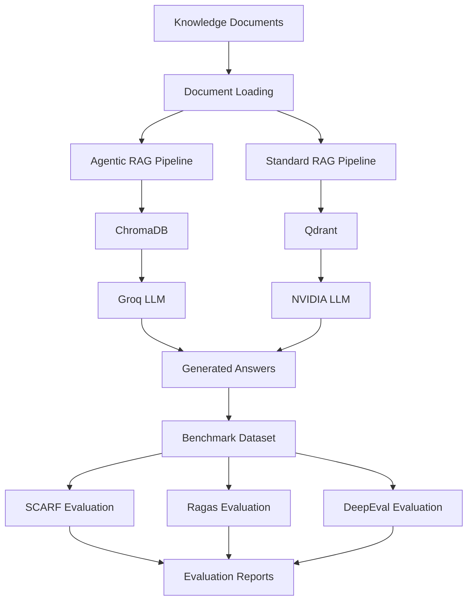

# Agentic RAG vs Standard RAG – Benchmark & Evaluation

A comparative benchmarking framework for evaluating **Agentic Retrieval-Augmented Generation (RAG)** against **Standard RAG** using multiple evaluation methodologies, including SCARF, Ragas, and DeepEval.

The project investigates whether an agent-driven retrieval strategy produces better answers, more relevant context, stronger factual grounding, and improved resistance to hallucinations compared with a conventional RAG pipeline.

---

## Project Overview

Retrieval-Augmented Generation (RAG) enhances Large Language Models (LLMs) by retrieving relevant information from external knowledge sources before generating responses.

However, different RAG architectures can produce different results in terms of retrieval quality, answer accuracy, latency, and hallucination resistance.

This project implements and evaluates two RAG architectures:

1. **Agentic RAG:** Uses LangGraph, ChromaDB, and Groq-powered LLMs.
2. **Standard RAG:** Uses Qdrant and NVIDIA-powered LLMs.

Both pipelines work with the same document collection and benchmark questions to make their performance comparable.

The generated answers are evaluated using three evaluation approaches:

- SCARF – Systematic evaluation of accuracy, relevance, completeness, and groundedness.
- Ragas – Evaluation of retrieval and generation quality.
- DeepEval – LLM-based evaluation of RAG performance.

## Architecture

### 1. Agentic RAG Pipeline

**Technology Stack:** LangGraph, LangChain, ChromaDB, Groq.

The Agentic RAG pipeline uses an agent-oriented architecture to handle user queries and retrieve relevant information from the knowledge base.

Main components:

- Document loading and processing.
- Embedding generation and vector indexing.
- ChromaDB vector storage.
- Agent-driven retrieval and response generation.
- Groq-powered LLM integration.

### 2. Standard RAG Pipeline

**Technology Stack:** LangChain, Qdrant, NVIDIA AI Endpoints.

The Standard RAG pipeline follows a conventional retrieval-augmented generation workflow.

Main components:

- Document loading and processing.
- Embedding generation and vector indexing.
- Qdrant vector storage.
- Similarity-based document retrieval.
- Context-based answer generation using NVIDIA models.

### Architecture Comparison

| Component | Agentic RAG | Standard RAG |
|---|---|---|
| Architecture | Agent-driven RAG | Conventional RAG |
| Framework | LangGraph / LangChain | LangChain |
| Vector Database | ChromaDB | Qdrant |
| LLM Provider | Groq | NVIDIA |
| Model | Qwen | Nemotron |
| Retrieval | Agent-oriented | Similarity-based |
| Evaluation | SCARF, Ragas, DeepEval | SCARF, Ragas, DeepEval |

---

## Evaluation Methodology

The project uses three evaluation methodologies to measure different dimensions of RAG performance.

### 1. SCARF Evaluation

SCARF-style evaluation measures the quality of generated answers using an LLM-as-a-Judge approach.

The evaluation uses a 1–5 scoring scale.

| Metric | Description |
|---|---|
| Accuracy | Measures factual correctness against the expected answer. |
| Relevance | Measures how directly the answer addresses the question. |
| Completeness | Measures whether the answer covers the essential information. |
| Groundedness | Measures whether the answer stays within the available knowledge and avoids unsupported claims. |
| Latency | Measures the time required to generate an answer. |

The evaluation judge uses NVIDIA Nemotron.

Results are exported to:

`scarf_eval_results.csv`

### 2. Ragas Evaluation

Ragas evaluates retrieval and generation quality using reference-based and reference-free metrics.

| Metric | Description |
|---|---|
| Faithfulness | Measures whether generated answers are supported by retrieved context. |
| Answer Relevancy | Measures how relevant the generated answer is to the question. |
| Context Precision | Measures the relevance of retrieved information. |
| Context Recall | Measures how much relevant reference information was retrieved. |

Results are exported to:

`ragas_eval_results.csv`

### 3. DeepEval Evaluation

DeepEval provides another evaluation perspective using LLM-based evaluation metrics.

| Metric | Description |
|---|---|
| Faithfulness | Evaluates factual consistency with retrieved context. |
| Answer Relevancy | Evaluates whether the answer addresses the input question. |
| Contextual Precision | Evaluates the relevance of retrieved context. |
| Contextual Recall | Evaluates the coverage of relevant information. |

Results are exported to:

`deepeval_eval_results.csv`

---

## Project Workflow



## Repository Structure

```text
agentic-vs-standard-rag-benchmark-evals/
│
├── src/
│   └── rag_Pipeline/
│       ├── Agentic_Rag/
│       │   ├── data_loader.py
│       │   ├── VectorStore.py
│       │   └── Rag_bot.py
│       │
│       └── Rag_Vector_pipeline/
│           ├── data_loader.py
│           ├── VectorStore.py
│           └── Rag_bot.py
│
├── app.py
│
├── eval_scarf.py
├── eval_ragas_deepeval.py
│
├── collected_outputs.json
│
├── scarf_eval_results.csv
├── ragas_eval_results.csv
├── deepeval_eval_results.csv
│
├── requirements.txt
├── pyproject.toml
├── uv.lock
├── .python-version
├── .gitignore
└── README.md
```

## Getting Started

### Prerequisites

- Python 3.12 or later
- Git
- Groq API Key
- NVIDIA API Key
- Access to the required document collection

### 1. Clone the Repository

```bash
git clone https://github.com/chandupradeep18/agentic-vs-standard-rag-benchmark-evals.git

cd agentic-vs-standard-rag-benchmark-evals
```

### 2. Create a Virtual Environment

Using Python:

```bash
python -m venv .venv
```

Activate the environment.

**Windows:**

```bash
.venv\Scripts\activate
```

**Linux / macOS:**

```bash
source .venv/bin/activate
```

### 3. Install Dependencies

```bash
pip install -r requirements.txt
```

Note: Ensure the environment also contains the Qdrant client, NVIDIA LangChain integration, Ragas, DeepEval, and other packages required by the respective modules. The dependency list may need updating as the project evolves.

### 4. Configure Environment Variables

Create a `.env` file in the project root.

```env
GROQ_API_KEY=your_groq_api_key
NVIDIA_API_KEY=your_nvidia_api_key
```

Never commit your API keys or `.env` file to GitHub.

### 5. Configure Your Document Directory

Update the `DATA_DIR` variable in the evaluation scripts and the document directory passed to the pipeline constructors.

Example:

```python
DATA_DIR = "./data"
```

Place your PDF, TXT, and other supported documents in the configured directory.

### 6. Run the RAG Application

```bash
python app.py
```

The application initializes the selected RAG pipeline and starts its interactive chat interface.

### 7. Run SCARF Evaluation

```bash
python eval_scarf.py
```

This evaluates both pipelines using the SCARF-style evaluation methodology and generates:

```text
scarf_eval_results.csv
```

### 8. Run Ragas and DeepEval

```bash
python eval_ragas_deepeval.py
```

This script collects or loads previously generated RAG outputs and evaluates them using Ragas and DeepEval.

Generated reports:

```text
ragas_eval_results.csv
deepeval_eval_results.csv
```

The output cache is stored in:

```text
collected_outputs.json
```

---

## Results and Benchmarking

The project generates structured CSV reports for comparing both architectures.

The benchmark focuses on the following dimensions:

| Evaluation Dimension | SCARF | Ragas | DeepEval |
|---|---|---|---|
| Accuracy | Yes | - | - |
| Relevance | Yes | Yes | Yes |
| Completeness | Yes | - | - |
| Groundedness | Yes | Faithfulness | Faithfulness |
| Context Precision | - | Yes | Yes |
| Context Recall | - | Yes | Yes |
| Latency | Yes | - | - |

**Important:** The repository contains evaluation output files. Actual performance conclusions should be drawn from the measured results rather than assumed in advance.

---

## Technologies Used

| Technology | Purpose |
|---|---|
| Python | Core programming language |
| LangChain | RAG application framework |
| LangGraph | Agentic workflow orchestration |
| ChromaDB | Vector database for Agentic RAG |
| Qdrant | Vector database for Standard RAG |
| Groq | LLM inference |
| NVIDIA AI Endpoints | LLM inference and evaluation |
| Ragas | RAG evaluation |
| DeepEval | LLM evaluation |
| Pandas | Evaluation result processing |
| Sentence Transformers | Embedding models |
| OpenAI Python SDK | API integration |
| Python-dotenv | Environment configuration |

---

## Research Objectives

This project aims to investigate the following questions:

1. Does Agentic RAG improve answer accuracy compared with Standard RAG?
2. Which architecture produces more faithful and relevant answers?
3. Does agent-driven retrieval improve context precision and recall?
4. Which architecture has lower response latency?
5. Which approach demonstrates better resistance to hallucinations?
6. What are the trade-offs between retrieval complexity and answer quality?

## Future Improvements

- Expand the benchmark dataset with more diverse documents and questions.
- Add additional embedding models and LLM providers.
- Introduce repeated benchmark runs for statistical reliability.
- Add retrieval-specific metrics such as MRR and Recall@K.
- Include token usage and inference cost measurements.
- Build a dashboard for visualizing evaluation results.
- Add automated experiment tracking and reproducibility.
- Compare additional RAG architectures and retrieval strategies.

## Author

**Chandu Pradeep**

GitHub: [@chandupradeep18](https://github.com/chandupradeep18)

Project Repository: [Agentic vs Standard RAG Benchmark & Evals](https://github.com/chandupradeep18/agentic-vs-standard-rag-benchmark-evals)

---

## License

Add an appropriate open-source license to the repository before distributing the project under a specific license.
